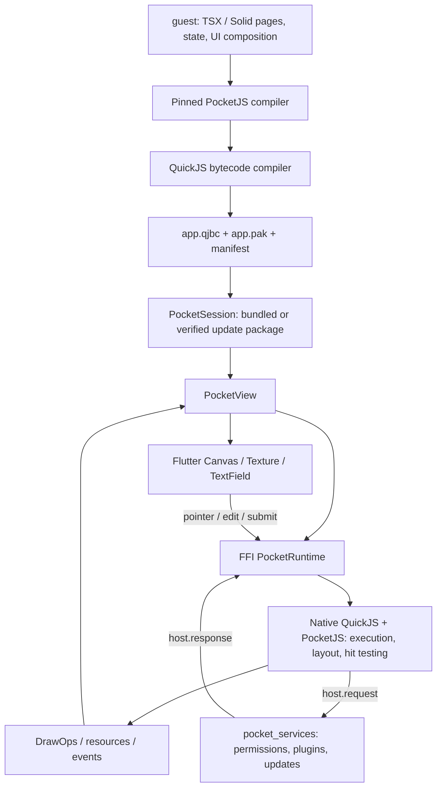

# Pocket Host source guide, capability boundaries, and Demo comparison

The 2026-11-02 audit covers `/Volumes/ORICO/Development/Github/pocket/sdk`. The sole Showcase consumer is `../demo`. Historical sections refer to pre-migration paths such as `guest/`, `host/`, and `packages/pocket_sdk/`. See the directory map below and [OVERVIEW.md](OVERVIEW.md) for current equivalents. Test results come from completed runs recorded in [VALIDATION.md](VALIDATION.md).

Sections 1–2 cover capabilities and the execution path. Section 3 maps directories and files. Sections 4–5 cover validation and support. Section 6 compares the two Demos, and sections 7–8 describe upcoming integration and where to make changes.

## 1. Current integration status

The working integration runs **JS-authored pages → precompiled QuickJS bytecode → PocketJS execution and layout → Flutter rendering and system input → native plugins → signed updates and rollback**. The project provides a working and extensible integration framework and capability showcase. A full production framework and complete migration of both Demos remain future work.

- JS owns pages, state, navigation, and UI composition. Flutter handles rendering, resources, the viewport, system keyboard, lifecycle, and capability invocation. The native PocketJS engine owns layout and hit testing.
- AOT in this project means **build-time QuickJS bytecode precompilation**. The production host loads `app.qjbc` and has no JS source fallback if bytecode execution fails.
- The old Demo counted 38 components, including 20 names related to upstream and 18 application compositions. PocketJS has four native node types, `view/text/image/surface`, and DrawList v1 has ten operation types. Validation covers a subset of these operations and components.
- The real execution path has been verified on macOS and on the iPhone Duo iOS simulator. This increment added the iOS hardware provider compiled into the host. The real MethodChannel integration passed on the Duo simulator for permission query, unsupported errors, and cleanup. Physical camera, BLE, and location testing remains pending, as do portions of Android, comprehensive input-device coverage, and sustained performance.
- This increment includes JS mobile UI, route transitions, the glass/platformTexture surface bridge, and local multi-file Editor scaffolding. Complex scroll, media, fonts, device input, and the complete regression matrix across both Demos remain partially migrated. The remaining examples provide reusable reference material.

Verification claims refer to the test scope listed here. Implemented code may still lack a current Demo entry point or validation on a given device.

## 2. Execution path



Most JS content becomes Canvas draw operations. Flutter supplies system integration where required, including the native text field and video textures.

### 2.1 Build pipeline

1. `scripts/prepare_upstream.py` downloads the pinned revision, validates the archive digest, and applies six controlled patches.
2. The shared `buildGuest()` entry point exported by `scripts/build_guest.ts` uses the same PocketJS/Solid tools to compile the consumer's JS entry and `@pocket/ui` compositions into intermediate JS and PAK resources. `pocket.ts build`, Editor, and the Demo's `js/package.json` all call it.
3. `native/src/bin/pocketjs_bytecode.rs` compiles the intermediate JS with the QuickJS version matched to the runtime and produces a PJBC-wrapped binary.
4. `../demo/assets/` receives bytecode, resources, bytecode metadata, and the capabilities manifest. Other consumers can write these artifacts into their own Flutter `assets/`. Intermediate JS stays in ignored directories such as `../demo/js/.pocket-build/`.
5. `scripts/build_native.sh` builds the Rust library for the target platform. The Flutter plugin uses it through FFI.
6. `sdk/editor/server.ts` shares the guest scaffold and supports multi-file editing, real QJBC/PAK builds, and signed publishing. `sdk/editor/test/editor_live_probe.ts` probes the production runner without changing Demo assets.

### 2.2 Startup, frames, and clicks

`demo/lib/main.dart → sdk/lib/pocket_sdk.dart/PocketApp → PocketSession → PocketView → FfiPocketRuntime → sdk/native/src/lib.rs`.

Native code executes the actual guest. PocketJS produces layout and a DrawList, Dart decodes it into a `PocketFrame`, and the painter renders it. Flutter sends pointers back to the engine in logical coordinates. JS `onPress` or gesture callbacks update state and generate another frame. The counter, navigation, and stress pages run through this path.

### 2.3 System keyboard and scrolling

`InputField` in `demo/js/ui/index.tsx` → `textInput.open/update/close` → Flutter `TextField` in `PocketView` → `textInput.edit/submit/dismiss` → JS draft.

JS measures the input position. Flutter retains the editing session, selection, and composing range and connects to the system IME. Position-only updates preserve text and composition. A stable outer key retains the same EditableText. Tapping outside requires a complete down/up sequence and excludes drags.

`ScrollablePage` reuses the official viewport/content pair, gestures, and kinetics. JS owns the scroll offset. The input field scrolls into view when the keyboard opens. During viewport resize, the auto-sized main canvas stays at 1:1 scale, anchored top left and clipping the old frame, so the page does not shrink and then spring back. Fixed-viewport previews and auxiliary surfaces have separate sizing policies. JS owns content scrolling, and Flutter keeps the viewport accurate at the framework boundary.

### 2.4 Plugins and updates

JS sends `host.request` with a requestId through `sdk/packages/pocket_ui/src/host.ts`. `sdk/lib/src/pocket_session.dart` forwards it to the service registry, which checks the declared capability and host grant, calls the handler, and returns a structured result to JS. The SDK includes `package_info_plus` by default. Showcase explicitly depends on `pocket_hardware` and registers its `HardwarePlugin` through `pluginFactories`. It supports structured camera/photo, BLE, sensor, biometrics, location, and weather requests and rejects unsupported, timed-out, or late results. `demo/test/hardware_plugin_test.dart` checks the public provider directly. Demo integration tests cover real iOS MethodChannel scenarios.

The update flow checks the manifest and signature, validates ABI and digest, downloads to cache, starts the candidate, and promotes it after confirmation that it is healthy. Failures restore a working version. Package switches replace the runtime and isolate renderer and host request callbacks by generation, discarding old session responses. `PocketSession.onError` cancels delayed mount and health timers, and `dispose` cancels them as well, so an old candidate cannot overwrite a rollback. Native Flutter plugins ship with the host binary and require a host release to update.

## 3. Current directory map

`sdk/` holds the reusable implementation and `demo/` is the example. The public SDK entry points are `sdk/lib/pocket_sdk.dart` and `sdk/pocket.ts`. The Flutter project lives at `demo/`, with its JS/TS project in `demo/js/`. Use the current directory map below for resolving paths. Historical paths describe where code and responsibilities originated.

```text
/Volumes/ORICO/Development/Github/pocket/
├── sdk/
│   ├── lib/                  # Public Flutter entry point for package:pocket_sdk
│   ├── packages/             # renderer, hardware, services, @pocket/ui
│   ├── native/               # Rust FFI, QuickJS runtime, bytecode compiler
│   ├── pocket.ts             # Single init/build/editor CLI
│   ├── scripts/ editor/      # Build, package signing, checks, and Editor service
│   └── docs/                 # Integration, provenance, validation, and performance
└── demo/
    ├── lib/ ios/ android/ macos/ assets/  # First-level Flutter host
    └── js/                   # app.tsx, @pocket/ui compositions, JS tests and scripts
```

## 3.1 Historical component responsibilities

```text
pocket_host/
├── guest/                         # JS app, UI library, state, and capability client
│   └── ui/                        # Compatibility exports; packages/pocket_ui owns base compositions
├── editor/                        # Local Pocket Studio multi-file editing/build/signing server and client
├── host/                          # Runnable Flutter host shell
│   ├── lib/                       # Startup, session, performance history, plugin adaptation
│   ├── assets/                    # Packaged qjbc / PAK / manifest
│   ├── integration_test/          # Real Flutter + native + guest execution
│   ├── test/                      # Host unit and widget tests
│   ├── test_driver/               # integration_test driver entry point
│   └── ios/ macos/ android/       # Platform startup and build configuration
├── packages/
│   ├── pocket_ui/                 # Public @pocket/ui JS compositions and display geometry
│   │   └── src/                   # Public ui/mobile/legacy/responsive/display entry points
│   ├── pocket_flutter/            # Reusable renderer/runtime adaptation
│   │   ├── lib/src/               # Rendering, frame model, FFI, resources, input
│   │   ├── test/                  # Renderer and protocol regressions
│   │   └── ios/ macos/ android/   # Native library linkage
│   ├── pocket_services/           # Reusable signed updates, capability, and plugin services
│   │   ├── lib/src/
│   │   └── test/
│   ├── pocket_hardware/           # Reusable hardware provider and iOS plugin compiled into the host
│   │   ├── lib/src/               # HardwarePlugin, capabilities/permissions, MethodChannel adapter
│   │   └── ios/Classes/           # PocketHardwarePlugin and real iOS manager
│   └── pocket_sdk/                # PocketApp/PocketSession facade for external applications
│       ├── lib/src/               # Config, session, performance history, package_info adapter
│       └── pubspec.yaml           # Depends on pocket_flutter/services/hardware
├── native/
│   ├── src/                       # Rust FFI and bytecode protocol
│   │   └── bin/                   # Bytecode compiler, probe, benchmarks
│   └── patches/                   # Minimal patches to pinned upstream
├── scripts/                       # Prepare, compile, sign packages, serve updates, check
│   └── tests/fixtures/            # Signature interoperability fixtures
├── tests/                         # JS state, real native execution, ablation checks
├── docs/                          # This guide, decisions, provenance, validation
├── AGENTS.md                      # Development boundaries, reuse-first and ablation rules
├── package.json                   # Bun command entry point
├── README.md                      # Startup, update, and verification instructions
├── state.md                       # Latest work snapshot
└── LICENSE                        # Project license; see PROVENANCE for upstream sources
```

### 3.1 `guest/` application layer and JS UI library

| File | Role | When editing |
| --- | --- | --- |
| `app.tsx` | Solid entry point for Home/Gallery/Host and Runtime, Bytecode, Updates, Plugins, Stress, FPS history, Mobile UI, Transitions, and Hardware. Connects capability responses, input events, state, and the 220 ms JS-owned route transition. | Add new pages and app interactions here first. Mobile components, hardware, and transition pages live in `mobile-pages.tsx`. Legacy capability pages continue through this entry point. SDK glass has no separate Demo page. |
| `state.ts` | Data structures and pure reducers for routes, counter, draft, capability loading/error/result, stress nodes, and performance history. | Keep application state here, including the route and counter. |
| `packages/pocket_ui/src/host.ts` | JS capability client for requestId, Promises, response parsing, timeout ticks, and disposal. | The host independently verifies and grants permissions. |
| `packages/pocket_ui/src/ui.tsx` | `SafeAreaScaffold` (canonical safe-area shell), Header, Button, Badge, Card, Tabs, List, Modal and other compositions, `InputField` system text sessions, `ScrollablePage` gestures, measurement and scrolling, and MiniBarChart. | Canonical source for `@pocket/ui`. `SafeAreaScaffold` consumes explicit `edges`. The guest owns pages, state, and routes. |
| `packages/pocket_ui/src/mobile.tsx` / `guest/mobile-pages.tsx` | `MobileThemeProvider`, `MobileScaffold` (reusing `SafeAreaScaffold`, nested default `safeArea="none"`), AppBar/Card/ListTile, controls/dialog, system `InputField`, and mobile/transition/hardware pages. `GlassSurface` and `PlatformTextureSurface` register only `glass` and `platformTexture`. Glass remains an SDK capability. | JS owns composition and state. The native provider accepts only those two surface kinds. |
| `packages/pocket_ui/src/legacy.ts` | Pure JS `computeTransitionDescriptor` for four transitions and `buildLiquidGlassRecipe` for SDF, parameters, and sampling. | Reuses mathematical descriptors from the source. The legacy UIKit renderer remains outside this integration. |
| `packages/pocket_ui/src/display.ts` | `createDisplayGeometry()` subscribes to `display.viewport` and returns a Solid signal via the existing `globalThis.__pocketEvent`. | PocketView sends geometry through existing transport without per-frame polling. When an old host omits the event, use the fallback without guessing the device model. |
| `packages/pocket_ui/src/responsive.ts` | `DisplayGeometry` parsing, `reservedInsets`, `availableDisplayRect`/`availableDisplayPanes`, `displayPane`, and `deriveResponsiveLayout`. Selects narrow/wide, bottom/rail, and pane from safe area, division, and occlusion. | Pane/frame values already use guest canvas coordinates. JS owns responsive layout, and division must be handled as geometry specific to the pane. |
| `guest/ui/index.tsx`, `guest/ui/mobile.tsx`, `guest/components.tsx`, `guest/legacy.ts` | Re-exports for legacy imports. | Update the one implementation in `packages/pocket_ui`. |
| `manifest.json` | Required and optional guest host capabilities and protocol versions. | Currently requires `text.glyphs.baked`. Updates, performance, and plugin capabilities are optional. The host grants permissions independently. |
| `pocket.json` | PocketJS compile entry, Solid framework, application ID, and default viewport. | Host runtime resizing is independent of compile-time configuration. |
| `release.ts` | Build-time release marker for the bundled guest, currently fixed to embedded. Development update scripts replace the page title to indicate v1/v2. | Signing, version admission, and cached health use their own metadata. |
| `pocket-mark.svg` | Sample image compiled into the PAK. | The SVG is an input to the resource compiler. |

The `List` in `packages/pocket_ui/src/ui.tsx` is a composition. Upstream `VirtualList` provides virtualization. Updates and FPS content currently nest an inner virtual list inside an outer scroll container. Edge handoff still needs targeted device tests.

### 3.2 `host/` startup shell and app integration

| File/directory | Role |
| --- | --- |
| `lib/main.dart` | Example Flutter entry point, importing only `pocket_sdk` and mounting the JS guest with `PocketApp(showcaseConfig)`. |
| `pubspec.yaml` | Depends on the public `pocket_sdk`, `pocket_hardware`, `pocket_flutter`/`pocket_services`, and example assets. Sessions and app services reuse the SDK. |
| `integration_test/` | Real Flutter/native/guest regression entry points for the sample host. Lifecycle implementation lives in the SDK. |
| `test/` | Example host and public provider unit tests. Hardware contract tests import `pocket_hardware` directly. |
| `assets/app.qjbc` | The actual QuickJS bytecode release artifact. |
| `assets/app.pak` | PocketJS images, fonts, and other resources. |
| `assets/app.bytecode.json` | Build diagnostics, including format, ABI, and digest. |
| `assets/guest-manifest.json` | Guest capabilities manifest copied at build time. |
| `analysis_options.yaml` | Dart static analysis rules. |
| `README.md` | Host directory notes. Start with the root README and this guide for the full framework. |
| `test_driver/integration_test.dart` | Flutter integration test driver, used only in tests. |

Rebuild generated assets from their source after changing application behavior.

### 3.3 `packages/pocket_flutter/` rendering and system integration

| File | Role |
| --- | --- |
| `lib/pocket_flutter.dart` | Public renderer/runtime API exports. |
| `src/pocket_runtime.dart` | PocketRuntime abstraction, FFI binding, runtime creation and disposal, package loading, messaging, frame retrieval, resize, errors, and ABI query. |
| `src/pocket_view.dart` | Main system integration point for StatefulWidget lifecycle, frame driving, resources and textures, input, TextField overlay, size changes, and FPS label. |
| `src/pocket_display_geometry.dart` | Optional iOS 27.1 ReservedRegion channel snapshot and shared PocketView listener reference counts. Falls back to empty geometry with an older OS or absent provider. |
| `src/pocket_surface.dart` | Retained `SURFACE_QUAD` providers `glass` and `platformTexture`. Impeller shader rendering is refractive. Non-shader and non-Impeller paths use a frosted fallback. |
| `src/pocket_view_painter.dart` | Main canvas and tile rendering, regions for hits and gestures, clipping, images, triangles, text, and repaint decisions. |
| `src/pocket_model.dart` | Dart models and decoding for PocketFrame, DrawOp, image resources, events, and auxiliary surfaces. |
| `src/pocket_assets.dart` | PAK image reading and pixel-format decoding. Update downloads live in services. |
| `src/pocket_display.dart` | Converts Flutter DPR to an integer 1–4 for resource raster density. Canvas keeps the actual DPR. |
| `src/pocket_package.dart` | Value object for local entry, PAK, and asset paths of admitted packages. It avoids copying large PAK files. The services package owns signed package models and verification. |
| `src/pocket_performance.dart` | Immutable PocketPerformanceSample metrics and serialization. PocketView samples ticker intervals and renderer bridge time. Performance integration tests collect Flutter FrameTiming and the host persists history. |
| `src/pocket_text_cache.dart` | TextPainter layout cache for reusing identical text layout across frames. |
| `ios/pocket_flutter/Package.swift`, `macos/*.podspec`, `android/build.gradle` | Link target native libraries into the Flutter plugin. iOS uses SwiftPM exclusively. |

Retained optimizations include incremental frames, paint tiles and RepaintBoundary, text LRU, and image identity/revision caching. `nativeMsP95` measures FFI, string copying, and Dart JSON decoding in addition to QuickJS execution.

### 3.4 `packages/pocket_services/` updates, capabilities, and plugins

| File | Role |
| --- | --- |
| `lib/pocket_services.dart` | Public service exports. |
| `src/pocket_host.dart` | Registers, authorizes, and dispatches host capabilities. Enforces shared error and budget rules for capability invocation. |
| `src/pocket_guest_manifest.dart` | Parses the guest manifest, required and optional capabilities, and version negotiation. |
| `src/pocket_package.dart` | Signed package manifest, canonical signature data, trusted Ed25519 key, blob digest and ABI validation. |
| `src/pocket_update.dart` | Fetches release information, downloads and caches packages, records versions, manages candidates and healthy versions, and rolls back or recovers. |
| `src/pocket_stream.dart` | Bounded message streams, cancellation, closing, and related service helpers. A full network streaming plugin is outside this implementation. |
| `src/pocket_plugin.dart` | PocketPlugin interface and manager for registration, activation, revocation, disposal, and capability exposure. |
| `test/` | Package admission, tampered signatures, permission and plugin lifecycle, and late response tests. |

Keep Canvas painting and business pages outside the services layer. Keep release channels, version lists, and business permissions outside the renderer.

### 3.5 `sdk/` (`pocket_sdk`) and `packages/pocket_hardware/` public host and compiled capabilities

| File | Role |
| --- | --- |
| `sdk/lib/src/pocket_config.dart` | Consumer bytecode, PAK, manifest, update, namespace, permission, and plugin factory configuration. JS owns page state. |
| `sdk/lib/src/pocket_app.dart` | Thin Flutter facade for `PocketApp`/`PocketGuest`. Mounts `PocketView` while JS owns routes and pages. |
| `sdk/lib/src/pocket_session.dart` | Starts bundled or verified update packages, isolates generations, promotes or rolls back on health, registers package-info/hardware/provider factories, and forwards performance data and host requests. |
| `sdk/lib/src/package_info_plugin.dart` | SDK provider using real `package_info_plus`, which consumers compile into the host. |
| `sdk/lib/src/performance_history.dart` | Persists up to 600 performance history entries per application. Frame state stays with the renderer. |
| `pocket_hardware/lib/src/hardware_plugin.dart` | `HardwarePlugin`, `HardwareCapabilities`, `HardwarePermissions`, MethodChannel and weather adapters, structured refusals and timeouts, late-result handling, and texture cleanup. |
| `pocket_hardware/ios/Classes/PocketHardwarePlugin.swift` | Standard Flutter auto-registration entry point invoking its module's `PocketHardwareManager`. External guests cannot download or replace this native implementation. |
| `pocket_flutter/ios/pocket_flutter/Sources/pocket_flutter/PocketFlutterPlugin.swift` | Standard auto-registration for the UIKit ReservedRegion geometry channel. Dart `PocketView` clips and transforms geometry into the local canvas before sending it to JS. |

The iOS Swift package for `pocket_flutter` links `PocketFlutter.xcframework`, retains the static archive via `-all_load`, and exports process symbols via `-export_dynamic`. Keep these FFI linkage requirements when editing the Swift package. The SDK package's iOS device Release build and final Runner FFI symbols were verified. Physical camera, BLE, GPS, and other hardware still require device and permission checks.

### 3.6 `native/` engine and bytecode

| File | Role |
| --- | --- |
| `Cargo.toml` / `Cargo.lock` | Rust dependencies, build types, and dependency pinning. Engine source comes from pinned upstream preparation. |
| `src/lib.rs` | C ABI entry points, HostState, QuickJS/PocketJS lifecycle, JS bridge, input queue, fixed ticks, layout, DrawList projection, image/font/video/auxiliary-surface data, and errors. |
| `src/bytecode.rs` | PJBC envelope, 124-byte header, format/flags/kind, engine ABI, binding/tick, length, and SHA-256 checks. |
| `src/bin/pocketjs_bytecode.rs` | Runs QuickJS compile-only and serialization at build time for runtime-compatible bytecode. |
| `src/bin/pocket_probe.rs` | stdin/stdout probe for real load, input, messaging, resize, and frame retrieval in end-to-end and ablation tests. |
| `src/bin/pocket_bench.rs` | Native performance comparisons, including full and delta frames. Flutter raster and device FPS require separate tests. |
| `patches/guest-rquickjs-bytecode.patch` | Actual bytecode loading for the pinned upstream guest. |
| `patches/guest-rquickjs-stack-size.patch` | QuickJS stack configuration. |
| `patches/guest-execution-budget.patch` | Execution budgets prevent a guest monopolizing execution. Process isolation is separate. |
| `patches/tex-quad-fractional-coverage.patch` | Fractional-coordinate texture coverage correction. |
| `patches/rgba-tileset.patch` | RGBA tileset resource support. |
| `patches/rgba-filter-helpers.patch` | RGBA/filter helpers. |

The pinned upstream revision is `99924de47c62fa36f526a8791055d91cbbdb3836`. `prepare_upstream.py` pins the archive SHA-256. Make persistent changes in controlled patches, build them, and add the relevant regression coverage. The generated `.cache/pocketjs` directory can be rebuilt.

### 3.7 `scripts/` development and release tools

| File | Role |
| --- | --- |
| `prepare_upstream.py` | Downloads and verifies pinned upstream. Applies patches idempotently and fails on conflicts. |
| `build_guest.sh` / `build_guest.ts` | Builds TSX, PAK, bytecode, and host assets. |
| `build_native.sh` | Builds native libraries for macOS, iOS simulator and physical iOS, and Android arm64, then copies them to the plugin directory. |
| `run_macos.sh` | Local macOS prep, build, and launch. |
| `check_architecture.py` | Checks project boundaries and disallowed dependencies. Interaction and visual correctness require runtime checks. |
| `test_guest.sh` | Runs the guest build and state, real native, and ablation checks. |
| `profile_macos.sh` | macOS profile benchmarks. |
| `package_update.ts` | Generates the release manifest, blob digest, and Ed25519 signature. |
| `serve_updates.ts` | Local development file server for device update tests. |
| `dev_updates.ts` | Creates local development key/config and publishes v1/v2/broken test releases. |
| `test_updates.ts` | Drives real update, rollback, and failure recovery tests. |
| `pocket.ts` | Consumer CLI. `init [--hardware]` generates a Flutter host, vendored `@pocket/ui`, manifest capabilities and permissions and, in hardware mode, iOS usage descriptions and Android manifest entries. Android host minSdk is at least 24. `build` reads project configuration and delegates to shared `buildGuest()`. |
| `tests/package_update.test.ts` | Signing-tool interoperability with Dart canonical format. |
| `tests/fixtures/pocket-package/` | Fixed test keys, Dart-signed manifests, and other fixtures for testing only. |

Run `bun editor/server.ts` to start the local management UI. The `editor/` server and client run outside the Flutter application runtime. `editor/test/editor_server.test.ts` covers HTTP, state, and signing. `editor/test/editor_live_probe.ts` verifies the release workflow with a real guest, QJBC compiler, and `scripts/package_update.ts`. `PocketSession` consumes the published `latest.json` and `host.json`. The `.tar.gz` artifact serves offline export only.

### 3.8 Platform directories

| Path | Role and status |
| --- | --- |
| `host/ios/Runner.xcodeproj`, `Flutter/` | SwiftPM and Flutter linkage and minimum iOS deployment target, currently 15.0. |
| `host/ios/Runner/AppDelegate.swift`, `Info.plist` | iOS/Scene lifecycle, `GeneratedPluginRegistrant` invocation, and platform declarations. The package plugins auto-register hardware and geometry providers. |
| `packages/pocket_flutter/ios/pocket_flutter/Sources/pocket_flutter/`, `packages/pocket_hardware/ios/Classes/` | Reusable Swift plugin registration, UIKit ReservedRegion bridge, and actual hardware manager. Consumers compile these from pubspec/SwiftPM and keep their Runner thin. |
| `host/macos/Podfile`, `Runner/Configs/`, Xcode project | macOS build and static native linkage, minimum 12.0. Verified on Apple Silicon. |
| `host/macos/Runner/MainFlutterWindow.swift`, `AppDelegate.swift`, entitlements | Window, application lifecycle, and platform permissions. |
| `demo/android/` | Gradle/Kotlin Flutter shell, Manifest, and resources. Permission ablation retained camera/BLE/location/biometrics, minSdk 24, and arm64-v8a native. APK build passed. Physical hardware validation remains pending. |
| Platform icons/storyboard/xcworkspace/RunnerTests | Platform project templates, launch resources, and native test shells. JS owns application pages. |

The iOS physical-device and simulator builds currently copy a static library to the same plugin path. Rebuild when switching targets. Multi-architecture XCFramework distribution remains outside this build flow.

### 3.9 Generated directories and documentation

| Path | Purpose |
| --- | --- |
| `.cache/pocketjs/` | Pinned upstream source and compiler cache, restored by preparation scripts. |
| `.pocket-build/` | Intermediate JS and build artifacts. The production host has no source fallback. |
| `.pocket-updates/` | Ignored local development private/public key configuration, releases, and local server root. Keep development private keys outside app resources. |
| `native/target/`, all `build/` directories | Rust and Flutter build artifacts. |
| `.dart_tool/`, `Pods/`, `.symlinks/`, `ephemeral/`, `node_modules/` | Toolchain caches and generated dependencies. |
| `artifacts/` | Local validation logs, benchmark data, screenshots, and recordings outside versioned source. |
| `docs/DECISIONS.md` | Layering, selected and excluded approaches, and ablation principles. |
| `docs/PROVENANCE.md` | Sources, pinned revisions, and licensing. |
| `docs/COMPONENTS.md` | Mapping for all 38 component names, underlying protocol, and support boundaries. |
| `docs/VALIDATION.md` | Platforms and test results actually run, plus unverified areas. |
| `docs/PERFORMANCE.md` | Benchmarks, methodology, caches, and ablation. |
| `docs/INPUT_REUSE.md` / `SCROLL_REUSE.md` | Input and scroll sources from both original projects, retained implementations, and adaptations. |

## 4. Test scope

| Path | What it verifies | What still needs separate evidence |
| --- | --- | --- |
| `tests/guest_state.test.ts` | Reducer, state, metrics, and JS bridge logic. | Flutter clicks, system keyboard, and actual rendering. |
| `tests/native_guest_probe.ts` | Actual bytecode, messages, pointers, input, resize, stress nodes, and DrawList. | Platform keyboard animation and raster FPS. |
| `tests/guest_ablation.ts` | Changing only JS and recompiling changes actual native output. | Complete component implementation. |
| `scripts/tests/build_guest.test.ts` | Shared `buildGuest()` preprocesses real `@pocket/ui` installed by an external project, emits actual QJBC and metadata, cleans temporary locks, and restores the source package. | Building or running the generated Flutter host on every platform. |
| Rust tests in `native/src` | Bytecode format, ABI, digest, execution, and input. | Release availability across platforms. |
| `packages/pocket_flutter/test/` | Frame model, rendering, caches, bytecode, input overlay, focus, and sampling boundaries. | Comprehensive physical-device IME, video, and fonts. |
| `packages/pocket_services/test/` | Signature/ABI/digest rejection, capability permissions, plugin revocation, and late responses. | Production rollout and full security review. |
| `tests/mobile_ui.test.ts` | JS mobile controls, four transition descriptors, glass recipe, surface bridge text contract, and route stack. | Flutter raster or physical iOS visual acceptance. |
| `packages/pocket_flutter/test/pocket_surface_test.dart` | `hostSurface` descriptor, clipping and paint order, glass BackdropFilter, texture after authorization, and revocation. | Actual camera frames and visual consistency on Impeller devices. |
| `demo/test/hardware_plugin_test.dart` | Direct provider tests for `pocket_hardware` descriptors, Android-shaped contract, unsupported/timeouts, camera texture registration/revocation, weather coordinates, and late results. | The coordinator runs device integration via `hardware_native_test.dart` separately. |
| `editor/test/editor_server.test.ts` / `editor/test/editor_live_probe.ts` | Multi-file API and out-of-root rejection, actual QJBC → PAK → signed publish, and rejection of stale builds after bad source. | Production publishing service, remote authorization, and concurrent users. |
| `demo/test/widget_test.dart` | Renderer mount smoke test with an injected static runtime. | End-to-end execution on the real engine. |
| `demo/test/performance_history_test.dart` | 600-entry limit, restoration, invalid data, and write failures. | Causes of spontaneous frame drops. |
| `integration_test/guest_interaction_test.dart` | Real taps, counter, navigation, bytecode/plugin/update errors, and stress page. | All Gallery control interactions. |
| `integration_test/update_lifecycle_test.dart` | v1/v2, rollback, invalid-package recovery, and remount from a healthy cache. | Production server, power-loss recovery, and multi-channel release. |
| `integration_test/system_keyboard_test.dart` | Real guest and TextInputClient, Chinese/emoji, selection/composing, delete, done, and retaining the draft. Uses TestTextInput for platform input. | Physical keys and language-specific keyboards. |
| `integration_test/system_keyboard_lifecycle_test.dart` | Actual iOS simulator keyboard opening, focus stability, field visibility, navigation hiding, and per-frame canvas scale and anchor. | Android, physical-device, and hardware keyboard behavior. |
| `integration_test/page_scroll_test.dart` | Real drags in Home and compact Gallery, reaching the bottom, and fixed Header/Nav. | Nested list handoff and all inertia boundaries. |
| `integration_test/performance_test.dart` | FrameTiming, native, UI, and raster metrics for specified scenarios. | Sustained 60 FPS in complex real workloads. |
| `integration_test/fps_history_test.dart` | Induced UI jank, low FPS in the label and file, and history restored on remount. | The root cause of naturally occurring 20+ FPS sessions. |

The recorded runs include the full update chain on macOS and iOS simulator, 15 renderer regressions, and iOS input and scroll checks. Older test counts are historical snapshots. See the latter half of VALIDATION for the latest focused input checks. A pass requires a recorded run.

## 5. Capability status

| Capability | Current status | Main boundaries |
| --- | --- | --- |
| Real JS execution with thin host | Implemented and verified on the real engine. | The native engine owns layout and hit testing. The host renders draw commands locally. |
| Precompiled QuickJS bytecode | Implemented and verified. | QuickJS bytecode depends on the engine ABI and matching QuickJS version. |
| Layout, text, buttons, and page state | Typical paths implemented and verified. | Full component and style coverage remains open. |
| Ten DrawList operation types | Host projection exists. Verify visual semantics individually. | `GLYPH_RUN` reuses glyph page/image/T8. Regular text keeps `TEXT_RUN`. Full Unicode shaping and arbitrary surface providers require separate support. |
| Images, textures, and resources | Implemented with partial validation. | Sample SVG compilation is recorded. Sprite, DeepZoom, and similar features need focused visual acceptance. |
| `SURFACE_QUAD` / host surfaces | Restricted general-purpose bridge. | Native registration and Dart rendering allow only `glass` and `platformTexture`. Video is a Texture provider of the latter. |
| JS mobile UI / transitions / glass SDK | Guest mobile UI and transition pages, pure JS descriptors, and glass/platformTexture bridge. SDK Liquid Glass recipe and surface remain available. The independent Demo page and options were temporarily removed. Source and unit checks are recorded. | Guest visuals require device acceptance. The refractive shader uses Impeller. Other renderers use the frosted fallback. |
| Flutter system keyboard | Current input bridge verified. | Upstream `GuestFrame.text` raw hardware keyboard and IME path is still disconnected. |
| Page scrolling and automatic input reveal | Main pages verified. | Nested VirtualList edge handoff and complex inertia remain pending. |
| JS UI library | Public `@pocket/ui` source exports base compositions, mobile, display geometry, and responsive panes. Guest pages compose these with app state. | The old Demo collection is partially migrated. CLI vendoring and compilation are available, with device layout and remaining components still to verify. |
| Signed updates, versions, and rollback | Real end-to-end chain verified. | Needs production release infrastructure, more failure recovery, and device coverage. |
| External plugins and iOS/Android hardware | Standard Flutter plugin registry compiles `package_info_plus` and `packages/pocket_hardware` into the host. Public `HardwarePlugin` has unit tests. | The coordinator runs real iOS and Android MethodChannel checks in `hardware_native_test.dart` per device. Native plugin updates require a host build. |
| FPS label and history | Actual low frame rates are recorded. | A short benchmark at roughly 60 Hz can coexist with natural 20+ FPS sessions. Use history to investigate the cause. |
| macOS and iOS simulator | Execution records exist. | Physical iOS and Android need separate acceptance. |
| iOS/Android hardware providers and physical devices | `pocket_hardware` includes MethodChannel, Texture cleanup, Android Camera2/Texture, and integration test source. The coordinator is validating actual devices. | Physical-device permissions, camera, and sensor results remain open, including physical Android. |

## 6. Comparison with the two preceding Demos

- **Kit** refers to `/Volumes/ORICO/Development/TryJoy.c/TryJoyMono/App/repos/pocket_flutter_poc/PocketJSKit`.
- **Legacy Demo** refers to `/Volumes/ORICO/Development/Github/pocketjs_flutter_demo`, excluding `pocket_host/`.

Evaluate reuse against implementations and runnable scenarios. Migration of an execution path and migration of its original sample coverage progress independently.

### 6.1 Legacy Demo scenarios and simulated paths

| Legacy Demo source | Actual implementation | Current status and reuse |
| --- | --- | --- |
| `buildPocketJsPageTree` and `dispatchPocketJsAction` in `lib/core/pocketjs_bundle_runner.dart` | Dart hydrates static VDOM, substitutes variables, dispatches app actions, and keeps six tabs and a page stack. | JS/Solid owns state and routes in the current host. Extract requirements such as navigation return values and freeze/resume from the legacy Dart executor. |
| `PocketFlutterUiRenderer` in `lib/render/pocket_ui_components.dart` | A 38-tag Dart widget switch with ListView, button actions, focus, and app styling. | Current JS compositions cover common UI. Complete Gallery, DeepZoom, wrapping, and paging examples by migrating their actual behavior individually. |
| `mini_apps/syslib/pocket_syslib_pages.js` | VDOM blueprints for six tabs and asynchronous subpages covering weather/permissions, BLE, 3D, 2D/video, components, and hot updates. | The current Demo covers fewer scenarios. Reuse scenarios, text, and pure calculations through existing JS UI and capability protocols. Validate hardware independently. |
| `mountPocketUiShowcase` in `mini_apps/app_ui_showcase.js` | Creates a Screen and returns `totalComponents: 38` without creating the 38 children. | Mount, interact with, and validate actual components individually. |
| `mini_apps/syslib/pocket_syslib_hardware.js` | Barometric altitude math, BLE packet parser, permission specifications and presets. | Pure JS helpers can be extracted and tested. The Hardware page already makes real BLE and sensor calls. Some advanced parsers and presets remain unmigrated. |
| `mini_apps/syslib/pocket_syslib_router.js` | Route/lifecycle descriptors and pure `computeTransitionDescriptor` math. | JS page switching exists. Full route stack, return results, prewarm, and freeze/resume remained partial at this snapshot. Reuse state semantics and animation math in JS. |
| `mini_apps/syslib/pocket_syslib_flutter_ui.js` | JS VDOM factories for Scaffold, Card, Material buttons, and related UI. | Dart hydration consumes the legacy output. Reuse API and composition requirements with the existing renderer. |
| `lib/core/real_hardware_bridge.dart` | Legacy real iOS MethodChannel for camera, photos, BLE, sensors, biometrics, GPS, and weather. Many exception and non-iOS branches return simulated data. | Reuse working paths separately. The Android provider follows the same Dart channel contract. Trace native handlers, permissions, and errors. Exceptions must preserve failure for authorization and photography. This increment did not complete physical-device validation. |
| `mini_apps/weather_forecast_app.js`, `app_login/main.js`, `app_nav/main.js` | Weather, login, shared-state, and BLE route scenarios. Some only return action descriptions. | These are extension examples. End-to-end behavior must be implemented and verified in current pages. |
| `mini_apps/syslib/pocket_syslib_graphics.js` | SVG descriptions. | Retain real icon specifications. Remove line/arc math commands with no consumer. 3D and particle rendering remain outside this work. |
| `native/pocket_runtime_multi.c` | Fixed-memory nodes, scene handles and transform buffers, fixed plugin responses, simulated permission/video advancement, and duplex echo. | Real Scene/Rapier, video decoding, and device services require their actual runtime paths. The simulated runtime was excluded. |
| `tools/compile_pocket_syslib_aot.py` | Produces a PJCA source envelope and prebuilt VDOM and writes them into the Dart runner. | Excluded from the implementation. Current AOT uses actual QuickJS QJBC. |
| `mini_apps/syslib/pocket_syslib_ota.js` | Semver, ABI gates, and version-management concepts. Some SHA checks inspect string length only. | Reuse pure version logic as applicable. Services owns real signature, digest, cache, and rollback behavior. |
| `mini_apps/pocketjs_runtime_bundle.js` | Navigator/plugin registry/deep-link API using old `globalThis.pocket_*` hooks. | Current calls use `host.request`. Deep links and plugin workflows remain unmigrated. |
| `mini_apps/pocketjs_uikit.js` | Tag list and Liquid Glass/SDF math. | Style math is available for reference. SDK Liquid Glass recipe/surface bridge and JS compositions migrated. The independent Demo Liquid Glass page remains hidden. Flutter provides the generic optical drawing surface. |
| `web_wasm_preview/`, `pocketjs_super_app_demo.html`, `wechat_host/` | Separate browser/WXML showcases or simulated hosts. | Outside the current Flutter scope. Flutter/QuickJS acceptance requires its own runtime tests. |

Several legacy wrappers expose only part of the behavior suggested by their names. `Lazy` is a container, `ScrollRail` is a visual progress indicator, `WrapLines` places separate Text elements per line, and `WrapTextPage` presents page-styled cards. Actual lazy loading, scroll control, width-aware wrapping, and pagination require functional counterparts.

- **Examples worth adapting to the thin host:** BLE and sensors, camera and photos, GPS and weather, biometrics, deep links, multiple input fields, complex lists, navigation results, and shared JS state. Confirm the native implementation and platform permissions before exposing them through capabilities. Package info and hardware providers already use real calls. Accept the remaining examples individually.
- **Outside the current scope or missing a dependency:** 3D scenes and physics, shared buffers/VFS, multi-sandbox scheduling, WeChat host, and browser simulator. Treat these as separate requests from the minimum Flutter host.

In legacy `ffi_bridge.dart`, the enum/tag mapping collapses 38 names into four node types. The tag creation loop in `tests/verify_architecture.py` proves storage only. The legacy Game Detail's `Scene`/`Host` globals and `.fsceneb` assets require a runnable 3D implementation outside this repository.

### 6.2 PocketJSKit comparison

Kit supplies the project's main runtime and rendering foundation. Flutter and native paths were retained selectively. Web-specific optimizations, business SDK modules, and test scenarios have independent migration status.

| Kit source | Retained or adapted | Gaps and limits |
| --- | --- | --- |
| `native/`, `packages/pocket_flutter/lib/src/pocket_runtime.dart` | Actual Rust RquickjsGuest/PocketJS, FFI, PAK, input, and frame model. Added QJBC compilation and admission. | The current host accepts Script bytecode only. The CLI compiles Modules, but host Module loading remains incomplete. |
| `pocket_view.dart`, `pocket_view_painter.dart`, `pocket_text_cache.dart` | Retained canvas tiles, RepaintBoundary, text LRU, image resource cache, and main/auxiliary canvases. | The current visual test set covers fewer scenarios than Kit. |
| Native `pocket_frame_delta` and related paths | Unchanged frames skip parts of DrawOp projection and transport. Resource export tracks changes. | Whole-frame JSON has an unchanged fast path. Partial-damage binary deltas are outside this protocol. Guest, layout, and draw still do work each frame. |
| `apps/shared/pocket_display.ts` | Reference for performance decomposition and test design. | Web DamageTracker, `renderScaledDamage`, idle null, 120 Hz scheduler, and Worker/transfer buffer were not ported directly to Flutter. Measure bottlenecks before choosing what to port. |
| `test/pocket_view_test.dart` | Renderer retains baseline paint, cache, and input regressions. | Port relevant fixtures and assertions for tile seams, safe area, video fit, auxiliary surfaces, and additional behavior. |
| `integration_test/pocket_viewport_integration_test.dart` | Current dynamic viewport, keyboard resize, and canvas anchoring have regressions. | Additional sizes, DPRs, and window resize scenarios can broaden coverage beyond the keyboard. |
| `integration_test/pocket_poc_test.dart` | Reusable Solid, input, resources, and aux test paths. | ResourceBoundary, Sprite UV, DeepZoom, Action/Axis/Motion, and auxiliary surfaces lack equivalent current acceptance. The old on-screen keyboard supplies scenarios for system input tests. |
| `apps/solid-tests/app.tsx` | Reusable upstream component and input scenarios. It informed the current system input wiring. | Many component-specific cases are outside the Gallery. Modal, directional focus, and resource-boundary behavior need dedicated interactive pages. |
| `apps/im/thread.tsx`, `apps/clear/app.tsx` | The viewport/content pair, gesture and kinetics handling, and scroll range measurement informed `ScrollablePage`. | Long lists, long messages with input, inertia boundaries, and nested scrolling need further scenarios. |
| List and scroll examples in `apps/companion-zero/` and `apps/3ds-demo/` | Reusable VirtualList and gesture patterns. | Keep list behavior in JS. Nested handoff remains unverified. |
| Engine `runtime` tileset op 23, `core/upload_tileset_tile`, and general texture export | Supplies part of the native TILESET/DeepZoom path. | DeepZoom lacks a fixture and device acceptance. Dart PAK fallback parses IMG only and lacks TILESET directory and eviction handling. |
| Native/Flutter video and `SURFACE_QUAD` | Retained host-surface bridge, `glass` provider, and `platformTexture` with video_player Texture. | Dedicated real video acceptance was pending at this audit. Allowed providers are only `glass` and `platformTexture`. Arbitrary compositors, 3D, and native views require separate support. |
| Auxiliary surface paths | A second logical surface and Canvas exist. | Physical external displays are outside this contract. Full component, interaction, and cleanup verification is pending. |
| Font and text resource paths | PAK font metrics, TEXT_RUN and Flutter text drawing, and GLYPH_RUN drawing from actual atlas pages. | Native text handles explicit newlines. The guest contract owns width-aware wrapping. Multilingual text, shaping, and font consistency follow upstream support and device verification. |
| Button/Axis/Motion input protocol | Native code parses and injects button, axis, relative axis, and motion data. | Gamepad and gyroscope providers are not wired into this protocol. `HardwarePlugin` sensors serve a separate capability lane. |
| Upstream physics ops 52–56 | Enabled real core bindings before guest initialization. | Native regressions cover world creation, disposal, and idle state. Complex collisions, events, and Showcase scenarios need focused acceptance. |
| `pocket_host.dart`, `pocket_stream.dart`, `pocket_plugin.dart`, package/update modules | Extracted and trimmed into **`packages/pocket_services`**, with example integration in `PocketSession`. | The renderer no longer exports the entire Kit API. Streams lack an actual provider. The general SDK and its full tests have no equivalent complete migration. |
| `pocket_game_container.dart`, `pocket_navigation.dart`, `pocket_game_config.dart` | `pocket_sdk/PocketSession` takes over part of startup and updates. Guest manifests describe capabilities independently. | Business routing stays in JS. Reuse needed lifecycle behavior individually from the game container, GameConfig, and general navigation bridge. |
| `editor/` Pocket Studio scaffold | Local multi-file editing, guest scaffolding, QJBC/PAK builds, signed release, and management UI. See `docs/EDITOR_REUSE.md`. | Legacy page-graph/WASM preview, story/reader templates, and COS were outside this work. The local Studio does not provide a multi-user production platform. |

The `apps/` examples are upstream PocketJS samples used by Kit, with some in its generated upstream cache. See [SCROLL_REUSE.md](SCROLL_REUSE.md) for local paths. They are outside the current packaged `guest/` pages. Native TILESET and physics source also reside in the pinned engine. Verify that a capability is actually enabled in the host.

Adapt real samples and tests into Demo pages using the existing engine and painter. Expose only the missing protocols needed to run them, and verify that each page is interactive.

### 6.3 Remaining service-layer gaps

This section records the static audit findings. Open items identify engineering gaps. Device acceptance requires executed records.

Fixed items with current source evidence

- When capability negotiation rejects a cached package, `PocketSession.initialize` clears `active`, sets `_resetCacheOnHealth`, and configures the bundled package again. `onError` and `dispose` cancel mount/health timers, and `generation` isolates obsolete callbacks. `integration_test/update_lifecycle_test.dart` covers candidate switching, bad-package recovery, and restarting from a healthy cache.
- `PocketPluginManager.activate` revokes inactive providers before each activation. A required permission or activation failure revokes host capabilities, calls provider `deactivate`, and cleans up the activation. `packages/pocket_services/test/` covers refusal, revocation, and late responses.
- `PocketSession._configureBridge` registers the SDK `PackageInfoPlugin` and consumer-configured pluginFactories. The Showcase factory registers `HardwarePlugin`, which supersedes the older package-info-only audit. The coordinator still verifies physical hardware.

| Gap | Current evidence and impact | Further validation |
| --- | --- | --- |
| Incomplete version and trust policy | `packages/pocket_services/lib/src/pocket_update.dart` and `pocket_package.dart` check signature, ABI, and hash. Version monotonicity, manifest expiration/replay policy, and key rotation are pending. | Distinguish user rollback from automatic downgrade. Test expired manifests, old signatures, and revoked keys. |
| Persistence crash window | Package store `_writeAtomic`/`_copyAtomic` delete the old target before rename, leaving a replacement window. | Inject process termination and disk errors and verify pointers and last-good recovery. |
| Permission experience incomplete | The consumer can configure host hardware grants with `allowedPermissions`. Activation waits for an explicit guest request before seeking OS permission through MethodChannel. Denial UI and copy are incomplete. | Real iOS and Android checks should cover allow, deny, revoke, and next-session cleanup. |
| Demo has no stream provider | A protocol and budget exist, while `PocketSession` has no stream provider. | Integrate a real subscription and test cancellation, backpressure, package switching, and revocation. |
| Memory budget is metadata | Plugin `memoryMb` describes a budget without process isolation or enforced limits. | Describe the actual contract and design and validate isolation separately where required. |
| Update policy concurrency | The store's public `activate()` requires a verifier. Commit, rollback, fallback, and policy install share the final admission lock. Session reverifies before publishing a candidate. | Same-isolate regressions exist. Cross-isolate and cross-process operations are outside the lock. |
| Release service and platform coverage | The loopback Editor generates `latest.json`, `host.json`, and signed blobs for `PocketSession`. Android at the time of this audit had a build entry point only. | Production releases, failure scenarios, and independent iOS hardware and Android acceptance remain open. |

Package tooling can still generate JS-format packages, and generic renderer APIs retain source loading. This sample's `PocketSession` opts into `requireBytecode: true`, so its production path accepts QJBC only.

The app installation package supplies trust for bundled guests. Remote updates pass through service signature admission. Native runtime validates bytecode structure, ABI, and payload digest. Current health means one first frame and approximately one second of execution. Complex business flows need separate checks.

## 7. Integration priorities and ablation

The audit identified these remaining tasks in priority order.

1. **Real interaction and sustained performance.** Adapt long forms, nested lists, input with scroll, and long text from the originals. Add Demo pages and physical-device regressions one at a time. Use FPS history to find naturally occurring drops, and inspect engine, FFI decode, UI, and raster independently.
2. **Visual protocols and resource scenarios.** Reuse Kit image, font, clipping, triangle, video, and auxiliary-surface examples and regressions first. Verify individually and document actual GLYPH_RUN, TILESET, DeepZoom, and surface-provider gaps.
3. **Input matrix.** Extend the existing system TextField bridge tests for focus changes, multiple fields, long text, different keyboards, and physical devices. If exposing `GuestFrame.text`, define where it interacts with the existing bridge to avoid duplicate edit/submit events.
4. **Hardware and permissions.** Test `HardwarePlugin` camera/Texture, photos, BLE, sensors, biometrics, and location/weather on iOS hardware individually before selecting further providers. Test denial, error, revocation, and switching for each.
5. **Publishing and platform acceptance.** The local Editor covers development. Remaining work includes production release services, key rotation, cache governance, interrupted downloads and disk failure, version policy, and Android coverage. Verify iOS hardware and Android separately.

Record each migration in `docs/` with original paths and behaviors, retained implementations, thin-host adaptations, executable checks, and redundant layers removed. Cite the source for each reused behavior.

Ablation removed the Dart application widget tree and simulated runtime, JS-painted on-screen keyboard, duplicate ActionBar, and empty ScrollRail, WrapLines, and pagination wrappers. Real compilation, clicks, and bytecode changes still drive the UI. Continue looking for duplicate state and wrappers in large files. Splitting a file should preserve the existing state machine and rendering backend.

## 8. Where to make changes

| Change | Start here | Acceptance |
| --- | --- | --- |
| New app page, navigation, counter/form state | `demo/js/app.tsx`, `demo/js/state.ts` | Reducer and real pointer, navigation, and returned state. |
| New UI composition | Review both Demos and `packages/pocket_ui/src/ui.tsx`, then use `@pocket/ui`. | Compose in JS, add to Gallery, and check clicks, focus, and layout. |
| Mobile UI, transitions, or SDK glass | `packages/pocket_ui/src/mobile.tsx`, `demo/js/mobile-pages.tsx`, `packages/pocket_ui/src/legacy.ts`, `packages/pocket_flutter/lib/src/pocket_surface.dart` | `tests/mobile_ui.test.ts` and `pocket_surface_test.dart`. Demo covers visible mobile and transition pages. SDK glass needs real iOS visual/Impeller acceptance. |
| Display geometry and responsive panes | `packages/pocket_ui/src/display.ts`, `packages/pocket_ui/src/responsive.ts`, `demo/js/app.tsx` | `display.viewport`, division/occlusion, narrow/wide, and actual Duo opening and closing. Use geometry without hard-coding device models. |
| Input or page scroll bug | Compare `packages/pocket_ui/src/ui.tsx` and `packages/pocket_flutter/lib/src/pocket_view.dart`. Read INPUT_REUSE/SCROLL_REUSE first. | Actual keyboard, real drag, and frame-by-frame viewport checks. Fix timing at the framework boundary. |
| New host capability or Flutter plugin | `pocket_services`, `pocket_sdk`, `pocket_hardware`, and guest manifest/client. Consumers enable providers through config. | Actual native invocation, permission denial, errors, teardown, and switching. iOS plugins auto-register through pubspec/SwiftPM. |
| Editor scaffold | `editor/server.ts`, `editor/client/`, `editor/test/editor_live_probe.ts` | Multi-file path boundaries, real QJBC/PAK, signed manifest/blob/host.json, and rejection of a stale build when source fails. |
| New draw operation or resource format | Upstream contract → `native/src/lib.rs` → Dart model/painter/assets. | Native output and Flutter pixel/visual regressions. |
| Update and version behavior | Services package/update, `pocket_sdk/PocketSession`, and publishing scripts. | Signed-package apply, rollback, invalid package, and restart. |
| Frame drops | FPS history, PERFORMANCE, and profiling scripts. | Same-scene before/after and ablation comparisons separating native, UI, and raster. |
| New platform | Native build, plugin platform directory, and host platform directory. | Independently verify build, launch, input, plugins, updates, and performance. |

See the [SDK README](https://github.com/PocketFlutter/Pocket/blob/b06cb43cac4d553cea232ae1cd1f9ed4ee0c4ff4/sdk/README.md) and [Demo README](https://github.com/PocketFlutter/Pocket/blob/b06cb43cac4d553cea232ae1cd1f9ed4ee0c4ff4/demo/README.md) for commands. Run `bun run build` in `demo/js` after changing Demo JS. The Demo's `bun run test:native` and `bun run test:ablation` force real JS execution and require native artifacts. A missing library leaves verification incomplete.

Document implementation, Showcase entry points, and device results independently. Update this guide, COMPONENTS when components change, and VALIDATION for new capabilities. Record source provenance and adaptations in the corresponding reuse document.
